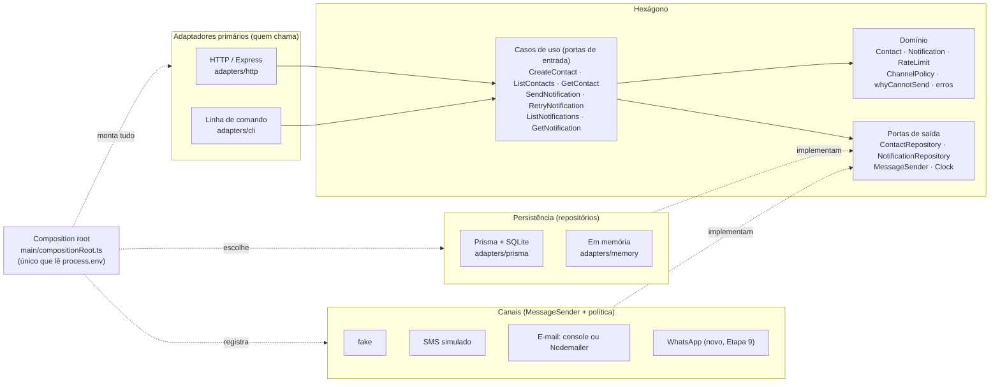

# Trabalho III — Notificações refatorado para Ports and Adapters

> **Autora:** Francine Moraes · Web II (TADS) · projeto-base: `notificacoes/` da Aula 07.
> A versão original (tudo num arquivo só) está guardada em [`legacy/index.ts`](legacy/index.ts).
> O README original da aula, com a API e o roteiro, continua mais abaixo.

## Como rodar

```bash
cp .env.example .env
npm install
npm run prisma:migrate          # cria o dev.db (o schema NÃO mudou)
npm run dev                     # API em http://localhost:3007 (mesmas rotas de antes)
npm test                        # 98 testes: unit + integration + contract

npm run dev:memory              # Etapa 9: sobe SEM banco (repositórios em memória)
npm run cli -- send --contact 1 --channels fake,whatsapp --message "Oi!"   # Etapa 9: CLI
EMAIL_PROVIDER=ethereal npm run dev   # Etapa 9: e-mail de verdade (link de pré-visualização no console)
```

| Script | O que roda |
| --- | --- |
| `npm run test:unit` | domínio, casos de uso, canais e a regra de direção das dependências (sem banco, sem HTTP) |
| `npm run test:integration` | adaptadores: Prisma × memória, HTTP, Nodemailer, CLI e Etapa 9 |
| `npm run test:contract` | Etapa 1: a API "por fora" (sobe o servidor de verdade) |
| `npm run test:contract:legacy` | **a mesma** suíte de contrato, contra o código original |
| `npm run typecheck` | checagem de tipos do TypeScript |

---

## Etapa 0 — o que o arquivo original fazia

### Responsabilidades encontradas no `src/index.ts` original

| Linhas (legacy/index.ts) | Responsabilidade | Para onde foi |
| --- | --- | --- |
| 11–25 | configuração (`process.env`) + criação do Prisma | `src/main/compositionRoot.ts` |
| 29 | caixa de entrada do canal fake (array global) | `src/channels/fake/fakeChannel.ts` |
| 37–60 | rota + validação do contato + gravação | HTTP: `adapters/http`; regras: `domain/Contact.ts`; banco: `adapters/prisma` |
| 57, 59, 64, 70 | conversão do `optOut` (texto ↔ lista) | `adapters/prisma/PrismaContactRepository.ts` |
| 79–86 | validação do formato do corpo e dos canais | formato: `adapters/http`; canal desconhecido: `SendNotification` |
| 91–98 | limite de 5 por minuto (com `Date.now()`) | `domain/RateLimit.ts` + porta `Clock` |
| 102–114 | regras de cada canal (opt-out, telefone, 160, e-mail, assunto) | `domain/Channel.ts` (`whyCannotSend`) + `channels/*/…Policy` |
| 129–143 e 191–205 | "provedores" (fake, SMS com `Math.random`, e-mail no console) | `channels/*` (um `MessageSender` por canal) |
| 144–153 e 206–216 | marcar SENT/FAILED e contar tentativas | `domain/Notification.ts` + `application/useCases/deliver.ts` |
| 177–181 | quando pode reenviar (SENT → 409, 3 tentativas → 409) | `Notification.ensureCanRetry()` |
| 161–174, 221–223 | consultas e caixa fake | `application/useCases/queries.ts`, `adapters/http` |

### Regras de negócio

1. Contato: nome com pelo menos 2 caracteres (sem espaços nas pontas).
2. Contato: e-mail, se informado, no formato `algo@algo.algo`.
3. Contato: telefone, se informado, no formato E.164 (`+` e 10 a 15 dígitos).
4. Contato: precisa ter e-mail **ou** telefone.
5. Contato: `optOut` só pode ter canais que existem.
6. Envio: todos os canais pedidos precisam existir.
7. Envio: o contato precisa existir.
8. Envio: no máximo **5 notificações por contato por minuto**.
9. Envio: cada canal aparece uma vez só, mesmo que venha repetido.
10. Canal: se o contato recusou o canal (opt-out), não envia.
11. SMS: exige telefone e no máximo **160 caracteres**.
12. E-mail: exige endereço e **assunto**.
13. Regra de canal violada no envio: a notificação é gravada como `FAILED`, com 0 tentativas, e a resposta continua 201.
14. Cada tentativa de entrega soma 1 em `attempts`. Sucesso: `SENT` com `providerId` e `sentAt`. Falha: `FAILED` com `lastError`.
15. Reenvio: só para o que não foi enviado e com menos de **3 tentativas**.
16. Reenvio: se a regra do canal continua violada, responde 422 e nada muda.

### Divergências entre as cópias do original (e o que foi decidido)

| # | Divergência encontrada | Decisão |
| --- | --- | --- |
| D1 | As regras de canal estavam **copiadas** no envio e no reenvio, mas a cópia do reenvio estava **incompleta**: faltavam o limite de 160 caracteres do SMS e o assunto obrigatório do e-mail. Um e-mail sem assunto, ao ser reenviado, saía com `Subject: null`. | **Corrigido.** Agora existe uma regra só (`whyCannotSend` + a política de cada canal), usada pelos dois. O reenvio desse e-mail agora é recusado com 422 (teste `DIVERGÊNCIA CORRIGIDA` em `test/unit/application`). |
| D2 | O trecho de envio (chamar o provedor e marcar SENT/FAILED) estava copiado nos dois handlers. | Unificado em `application/useCases/deliver.ts`. |
| D3 | O limite por minuto contava os canais **repetidos** (`["fake","fake"]` contava 2), mas só enviava 1. | Corrigido: conta os canais sem repetição, que são as notificações que de fato serão criadas. |
| D4 | A mesma regra de canal violada dá respostas diferentes: no envio vira notificação `FAILED` (201), no reenvio vira 422. | **Mantido**, porque faz parte do contrato. A regra é uma só, e cada caso de uso decide o que fazer com o resultado. |
| D5 | `GET /notifications/:id` devolve o contato com `optOut` em texto (`"sms,email"`), enquanto as rotas de contato devolvem lista. | **Mantido** para não quebrar o contrato. A conversão está isolada em `adapters/http/presenters.ts`. |
| D6 | `/contacts/abc`, `?contactId=abc` e JSON malformado viravam erro do Prisma/Express, **com stack trace** na resposta. | Corrigido: 404, 400 e 400, sempre em JSON. Erro inesperado vira `500 { "error": "erro interno do servidor" }`, e o detalhe vai só para o log. |
| D7 | O retry não passava pelo limite por minuto. | Mantido: reenviar não cria notificação nova. |

### O contrato (status e formato)

Registrado em [`test/contract/api.contract.test.ts`](test/contract/api.contract.test.ts): **34 testes caixa-preta** que
sobem o servidor num processo separado e só falam HTTP com ele. A suíte passa **igual** contra o original
(`npm run test:contract:legacy`) e contra o refatorado (`npm run test:contract`), sem nenhuma alteração.

O que dificultou testar o original (Etapa 1): não havia uma função que criasse o app, já que o arquivo já
conectava no banco e chamava `listen` ao ser importado. Além disso, `Math.random()` e `Date.now()` estavam no
meio do código. A saída foi subir **dois servidores no mesmo banco**, um com `SMS_FAILURE_RATE=0` e outro com
`SMS_FAILURE_RATE=1`, para conseguir testar o reenvio. Já o "avançar o relógio" para o limite por minuto não
dava para fazer, e depois da refatoração passou a ser um teste simples (`clock.advance(61_000)`).

---

## A arquitetura



### Onde está cada coisa

```
src/
├── domain/                 regras de negócio puras (não importam nada de fora)
│   ├── Contact.ts            o que torna um contato válido; opt-out
│   ├── Notification.ts       estados (enum), tentativas, quando pode reenviar
│   ├── RateLimit.ts          5 por minuto
│   ├── Channel.ts            contrato ChannelPolicy + whyCannotSend (regra geral de canal)
│   └── errors.ts             erros de negócio
├── application/
│   ├── ports/                portas de SAÍDA (interfaces) + ChannelCatalog
│   └── useCases/             portas de ENTRADA (uma classe por operação) + deliver.ts
├── channels/               um pacote por canal: política (regras) + sender(s) (provedor)
│   ├── fake/  sms/  email/  whatsapp/
├── adapters/
│   ├── http/                 Express: rotas finas, presenters, errorHandler (erro → status)
│   ├── cli/                  linha de comando (Etapa 9)
│   ├── prisma/               repositórios com Prisma (o único lugar com @prisma/client)
│   └── memory/               repositórios em memória
├── main/compositionRoot.ts  lê a configuração, escolhe e conecta tudo
├── index.ts                 sobe o HTTP
└── cli.ts                   sobe a CLI
```

O teste [`test/unit/architecture.test.ts`](test/unit/architecture.test.ts) **verifica sozinho** as regras de
dependência: `domain/` e `application/` não importam Express, Prisma, Nodemailer, dotenv, adaptadores nem
canais. Ele também confere que só o composition root lê `process.env` e que o `@prisma/client` só aparece em
`adapters/prisma`.

### Granularidade das portas (justificativa)

**Envio: uma porta pequena (`MessageSender.send(contato, conteúdo) → providerId`) com uma implementação por
canal**, em vez de uma porta "faz-tudo" com um `if` por canal dentro. Assim, os casos de uso nunca perguntam
"qual canal é?": eles pedem ao `ChannelCatalog` o canal pelo nome e chamam `send`. Adicionar um canal é
escrever uma classe nova e registrá-la, sem mexer em nenhum `if`. **As regras de cada canal ficam separadas do
provedor** (`ChannelPolicy` × `MessageSender`), porque são coisas que mudam por motivos diferentes: a regra
"e-mail exige assunto" continua valendo quando o e-mail simulado é trocado pelo Nodemailer, então os dois
provedores usam a mesma política. Esse contrato `ChannelPolicy` está no domínio: é assim que o domínio fica
sabendo das regras de um canal sem conhecer o provedor. **Persistência: um repositório por entidade**
(`ContactRepository`, `NotificationRepository`), com métodos que falam a língua do caso de uso, como
`countCreatedSince(contato, desde)` para o limite por minuto, em vez de expor consultas genéricas do banco.
**Tempo: uma porta `Clock`**, porque `new Date()` no meio da regra impedia testar o limite por minuto. Não criei
porta para gerar ids, porque quem gera o `providerId` é o próprio provedor (adaptador), e o id da notificação
vem do repositório. Os casos de uso não usam nada aleatório.

### Outras decisões

- **Canal como texto, não como `'fake' | 'sms' | 'email'` no domínio.** Uma lista fechada no domínio obrigaria
  a mexer nele a cada canal novo. Os estados (`PENDING/SENT/FAILED`), que não mudam, viraram um enum
  (`NotificationStatus`) que o compilador verifica.
- **Casos de uso como classes com `execute`**, que recebem as portas no construtor (igual ao projeto da Aula 06).
- **Validação de formato × regra de negócio:** "o corpo tem `contactId`, `channels` (lista) e `message`?" é
  formato, então fica no adaptador HTTP. "O nome tem 2 caracteres?", "o SMS cabe em 160?" e "já passou de 5
  por minuto?" são regras, então ficam no domínio.
- **Erros → status num lugar só** (`adapters/http/errorHandler.ts`): 400 validação/canal desconhecido,
  404 não encontrado, 409 já enviada/tentativas esgotadas, 422 regra de canal no reenvio, 429 limite,
  500 genérico para o resto.
- **A caixa de entrada fake não passa por caso de uso.** Ela não é regra de negócio, é uma ferramenta para
  inspecionar o provedor fake. O composition root entrega a mesma instância ao adaptador HTTP.
- **O schema do Prisma não mudou** (o `optOut` continua texto no banco). A conversão para lista é detalhe do
  adaptador Prisma.

---

## Etapa 9 — provas

| Prova | Como foi feita | O que mudou | Domínio/casos de uso alterados? |
| --- | --- | --- | --- |
| **Canal novo** | WhatsApp simulado: `src/channels/whatsapp/whatsappChannel.ts` | 1 arquivo novo + 1 linha no composition root | **Não** |
| **E-mail de verdade** | `NodemailerEmailSender` (Ethereal ou qualquer SMTP, como o Mailtrap), escolhido por `EMAIL_PROVIDER` | 1 arquivo novo + a escolha no composition root | **Não** |
| **Segundo adaptador primário** | CLI (`src/adapters/cli/runCli.ts` + `src/cli.ts`) chamando os mesmos casos de uso | 2 arquivos novos | **Não** |
| **Só memória, sem Prisma** | `PERSISTENCE=memory` (`npm run dev:memory`). O Prisma nem é carregado (import dinâmico) | só configuração | **Não** |

Teste de cada uma em [`test/integration/etapa9.test.ts`](test/integration/etapa9.test.ts). O teste
`ETAPA 9 — canal novo...` em `test/unit/application` mostra que até um canal inventado ("pombo") funciona só
sendo registrado no catálogo.

**E-mail de verdade com Ethereal:** `EMAIL_PROVIDER=ethereal npm run dev` cria na hora uma conta de teste no
[Ethereal](https://ethereal.email). Cada e-mail enviado imprime no console um link do tipo
`https://ethereal.email/message/...`, onde dá para abrir a mensagem. Testado em 14/10/2026: o e-mail foi aceito
pelo SMTP do Ethereal. Para usar o Mailtrap, preencha `EMAIL_PROVIDER=smtp` e as variáveis `SMTP_*` do
`.env.example`.

---

## Checklist de entrega

- [x] Todas as rotas respondem com os mesmos status e formatos da versão original (34 testes de contrato, que passam contra o original e contra o refatorado).
- [x] Domínio e casos de uso não importam `express`, `@prisma/client` nem nada de infraestrutura (verificado por `architecture.test.ts`).
- [x] Nenhuma regra de negócio está duplicada (divergências D1–D3 corrigidas e registradas acima).
- [x] Existe um único lugar que instancia e conecta as dependências (`src/main/compositionRoot.ts`), e só ele lê `process.env`.
- [x] Os casos de uso são testáveis sem banco, sem HTTP e sem aleatoriedade (`test/unit/application`, com relógio fixo e provedores dublês).
- [x] Um canal novo foi adicionado sem tocar no domínio nem nos casos de uso (WhatsApp).
- [x] Um diagrama (Mermaid) mostra o hexágono, as portas e os adaptadores.
- [x] Um parágrafo justifica as decisões de granularidade das portas.

---

# Aula 07 — Serviço de notificações multicanal

Uma API que envia notificações para contatos por três canais:

| Canal   | O que acontece de verdade                                                     |
| ------- | ----------------------------------------------------------------------------- |
| `fake`  | A mensagem vai para uma caixa de entrada em memória (`GET /fake-inbox/:id`).  |
| `sms`   | Imprime no console e falha aleatoriamente (`SMS_FAILURE_RATE` no `.env`).      |
| `email` | Imprime no console um "e-mail" com remetente, destinatário e assunto.         |

**O código inteiro está em um único arquivo: [`src/index.ts`](src/index.ts).** Configuração, banco de dados, regras de negócio, integração com provedores e rotas HTTP estão todos misturados, de propósito. O sistema funciona — e o trabalho desta aula é transformá-lo em uma arquitetura **Ports and Adapters (hexagonal)** sem mudar o comportamento da API.

O material de conceito é o da aula anterior: [`Aula06/arquitetura-hexagonal.md`](../../Aula06/arquitetura-hexagonal.md). O projeto [`Aula06/project-management`](../../Aula06/project-management/) serve de referência de como um projeto hexagonal fica organizado.

---

## Como rodar

```bash
cd Aula07/notificacoes
cp .env.example .env
npm install
npm run prisma:migrate    # cria o banco SQLite (dev.db)
npm run dev               # http://localhost:3007
```

As requisições de exemplo estão em [`test.http`](test.http) (extensão REST Client do VS Code).

## A API

| Método | Rota                          | Descrição                                                     |
| ------ | ----------------------------- | ------------------------------------------------------------- |
| POST   | `/contacts`                   | Cria contato (`name`, `email?`, `phone?`, `optOut?`)          |
| GET    | `/contacts`                   | Lista contatos                                                |
| GET    | `/contacts/:id`               | Detalhe de um contato                                         |
| POST   | `/notifications`              | Envia (`contactId`, `channels[]`, `message`, `subject?`)      |
| GET    | `/notifications`              | Lista, com filtros `?status=`, `?channel=`, `?contactId=`     |
| GET    | `/notifications/:id`          | Detalhe de uma notificação                                    |
| POST   | `/notifications/:id/retry`    | Reenvia uma notificação que falhou                            |
| GET    | `/fake-inbox/:contactId`      | Mensagens recebidas pelo canal `fake`                         |

---

## Roteiro de refatoração para Ports and Adapters

O roteiro diz **o que** fazer em cada etapa, não **como**. As decisões de nomes, pastas, interfaces e granularidade são de vocês — e devem ser justificáveis. Idealmente a API precisa continuar funcionando em todas etapas.

### Etapa 0 — Entender antes de mexer

- Rodem o sistema e exercitem todas as rotas do `test.http`, inclusive os caminhos de erro.
- Leiam o `src/index.ts` inteiro e marquem cada trecho com a responsabilidade que ele cumpre (configuração, entrada HTTP, validação de formato, regra de negócio, persistência, integração externa…).
- Façam uma lista de **todas as regras de negócio** que vocês encontrarem. Elas estão espalhadas e algumas aparecem mais de uma vez — verifiquem se as cópias são realmente iguais.
- Registrem o comportamento atual (status HTTP e formato das respostas) de cada rota. Esse é o contrato que não pode quebrar.

### Etapa 1 — Rede de segurança

- Antes de mover qualquer código, escrevam testes que exercitem a API por fora (caixa-preta), cobrindo os casos de sucesso e de erro levantados na Etapa 0.
- Encontrem um jeito de tornar o comportamento aleatório e dependente de tempo (falha do SMS, limite por minuto, datas) controlável nos testes. Anotem o que dificultou isso — é um sintoma que a arquitetura deve resolver.

### Etapa 2 — Descobrir o domínio

- Identifiquem os conceitos centrais do negócio e representem-nos em código que **não importa** Express, Prisma nem nenhuma biblioteca de infraestrutura.
- Levem para dentro desses conceitos as regras que pertencem a eles (o que torna um contato válido, quando uma notificação pode ser reenviada, o que cada canal exige…).
- Substituam as strings soltas que representam estados e canais por algo que o compilador consiga verificar.
- Decidam onde vivem as regras que são específicas de um canal e como o domínio fica sabendo delas sem conhecer o provedor.

### Etapa 3 — Casos de uso (portas de entrada)

- Identifiquem as operações que o sistema oferece do ponto de vista de quem o usa, independentemente de HTTP.
- Cada operação vira um caso de uso com entrada e saída próprias, que orquestra o domínio e não sabe de onde veio a requisição.
- Eliminem a duplicação entre "enviar" e "reenviar": a regra deve existir em um só lugar.

### Etapa 4 — Portas de saída

- Listem tudo o que os casos de uso precisam do mundo externo: guardar e buscar dados, entregar mensagens, saber a hora atual, gerar identificadores…
- Para cada necessidade, definam uma porta expressa na linguagem do domínio, não na linguagem da tecnologia que vai implementá-la.
- Reflitam sobre a granularidade: uma porta de envio para todos os canais, ou uma por canal? Qual escolha torna mais fácil adicionar um canal novo?

### Etapa 5 — Adaptadores secundários (driven)

- Implementem as portas de persistência com Prisma. O Prisma Client não pode aparecer fora desses adaptadores.
- Implementem um adaptador para cada canal de envio (fake, SMS, e-mail), preservando o comportamento atual de cada um.
- Criem também implementações em memória das portas de persistência, para uso nos testes.
- Garantam que tipos do Prisma não vazem para o domínio nem para os casos de uso.

### Etapa 6 — Adaptador primário (driving) HTTP

- Reescrevam as rotas Express como um adaptador fino: traduzir a requisição para a entrada do caso de uso, chamá-lo e traduzir a saída (ou o erro) para uma resposta HTTP.
- Separem validação de formato da requisição (responsabilidade do adaptador) das regras de negócio (responsabilidade do domínio).
- Definam como erros do domínio viram status HTTP em um único lugar, e garantam que nenhum erro interno (stack trace, mensagem do Prisma) chegue ao cliente.

### Etapa 7 — Composition root

- Criem um único ponto onde as dependências concretas são instanciadas e conectadas às portas.
- A escolha de implementação (ex.: probabilidade de falha do SMS, banco a usar) deve ser feita ali, a partir da configuração — em nenhum outro lugar se lê `process.env`.
- Verifiquem a direção das dependências: nada dentro do hexágono pode importar algo de fora dele.

### Etapa 8 — Testes em camadas

- Testem o domínio isoladamente, sem banco e sem HTTP.
- Testem os casos de uso usando os adaptadores em memória e dublês das portas de envio.
- Mantenham os testes da Etapa 1 passando sem alteração — eles provam que o contrato da API foi preservado.

### Etapa 9 — Provar que a arquitetura funciona

Cada item abaixo deve ser feito **sem alterar o domínio nem os casos de uso**. Se precisarem alterar, voltem e revejam as fronteiras.

- Adicionem um novo canal (ex.: push ou WhatsApp, também simulado).
- Troquem o provedor de e-mail simulado por um que envie de verdade (ex.: Nodemailer com Ethereal ou Mailtrap), escolhido via configuração.
- Adicionem um segundo adaptador primário (ex.: um CLI que envia uma notificação pela linha de comando) reutilizando os mesmos casos de uso.
- Façam a aplicação subir usando apenas os repositórios em memória, sem Prisma.

---

## Checklist de entrega

- [ ] Todas as rotas respondem com os mesmos status e formatos da versão original.
- [ ] Domínio e casos de uso não importam `express`, `@prisma/client` nem nada de `node_modules` de infraestrutura.
- [ ] Nenhuma regra de negócio está duplicada.
- [ ] Existe um único lugar que instancia e conecta as dependências.
- [ ] Os casos de uso são testáveis sem banco, sem HTTP e sem aleatoriedade.
- [ ] Um canal novo foi adicionado sem tocar no domínio nem nos casos de uso.
- [ ] Um diagrama (pode ser manual/Mermaid) que mostra o hexágono, as portas e os adaptadores do projeto final.
- [ ] Um parágrafo no README justifica as principais decisões de granularidade das portas.
